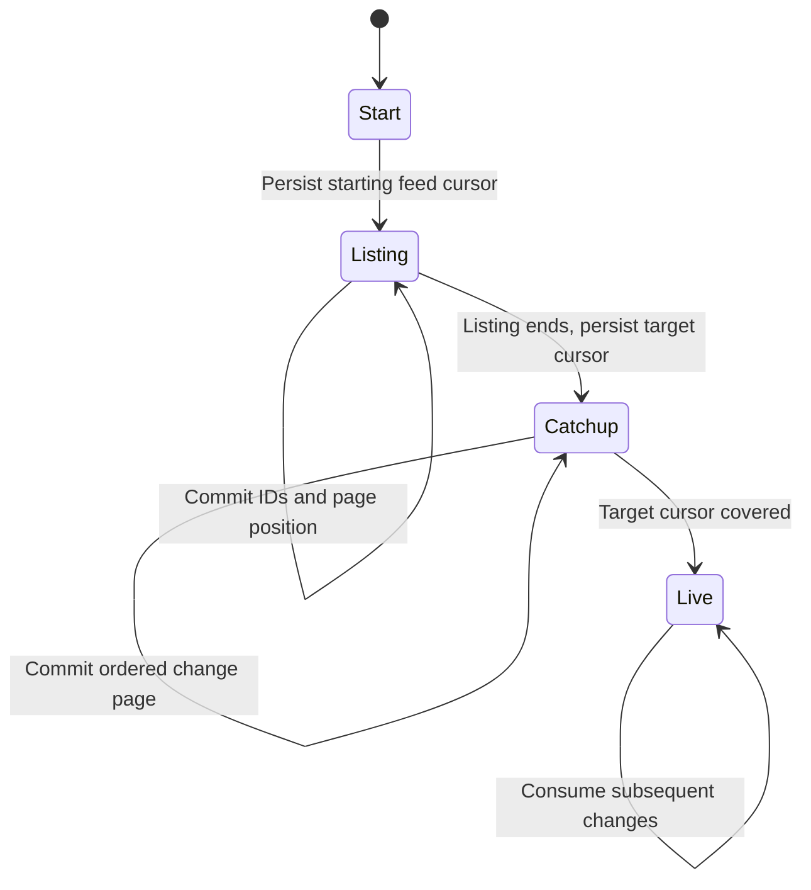

# First download and change-feed handoff

A fresh installation needs the body of every active node for offline use. Techo already lists active nodes in ID order and returns their full content on individual reads. The server's [progress ledger](../../techo/.plans/progress.md) lists the change-feed endpoint as unplanned. This design proposes a server contract for discussion.

## Cutover protocol

1. Read a committed feed cursor for this account **before** requesting the first list page. Persist it in SQLite with the installation identity. Resume this checkpoint after restart.
2. Walk the flat active-node list using the server's continuation. For each page, store the node IDs and required revisions together with the next list position in one transaction. Merge requirements by maximum node revision. An empty account still proceeds to catch-up.
3. After the last page, read and persist a second committed cursor as the catch-up target. Replay from the **starting** cursor, recording all obligations and advancing the consumed cursor atomically for each ordered page. A page that includes changes past the target can be consumed whole. Cursor coverage must be unambiguous in the feed contract.
4. Once replay covers the target, hand that same durable cursor to [incremental incoming sync](incoming.md). Fetching bodies can run during listing and replay. A body read ahead of the feed can satisfy that node's content obligation. Only feed consumption advances the account cursor.
5. Track **offline availability** separately from **live feed tracking**. Keep a durable list of outstanding bodies, deferred file writes and conflicts. Report the initial offline copy complete when every active node covered by the initial download has current full content available locally, or later observations account for its removal. If local edits require review, preserve both versions and report the pending review. Newer changes continue through ordinary sync.

For existing managed files, match by UUID within the configured scope. A differing local file with no common base goes to review. Preserve unrelated files, shared headings and unsaved buffers as specified in [sync.md](sync.md). A restart of an established installation resumes its saved cursor and missing-local decisions.

## Why the first cursor matters

Suppose the client has already listed through ID 50. Another device creates ID 20, then the client finishes the list. The remaining pages start after 50, so the list misses 20. Recording only the final cursor also skips its create event. With the starting cursor already on disk, the replay delivers ID 20. The same argument covers a node becoming active behind the list position.

A concurrent purge creates a second race. The list can include a node whose body GET later returns 404. Keep its obligation and continue consuming the feed. A confirmed purge tombstone can settle it. A bare 404 or a transient read failure cannot silently count as a downloaded body. Lifecycle and graph notifications require their own handling when integrating with the content-only incoming machine.

## Proposed server contract

- A read returns a committed per-account high-water cursor. The feed supports ordered, gap-free replay after that cursor and a way to tell when a later high-water cursor is covered. These guarantees can share an endpoint.
- Node writes and their feed records commit together. The feed exposes activations, updates, moves, removals and purge tombstones. The list and GET must observe at least the writes committed at the starting cursor.
- Replay must remain available across a supported bootstrap, including restart, or the server must signal an expired cursor. On expiry, repeat discovery from a new starting cursor, preserving local edits, existing identities, and missing-local markers. An unavailable feed leaves the client able to stage a list download, with the cutover still pending.
- If the server instead offers complete replay from the account's origin, replaying the whole history is a viable alternative for a fresh installation. The two-cursor proposal bounds replay to activity during the scan and avoids requiring a transaction spanning list pages.

## Executable verification

Run `python3 .plans/check-bootstrap.py`. The [model](check-bootstrap.py) separates receipt of a response from its durable commit. A server write can occur between those steps, and a restart can discard the staged response. List and feed pages contain one item. A body fetch can observe a newer node revision than the feed has consumed.

Named traces exercise creation behind a committed list position, a page lost before checkpointing, a new write after the catch-up target, and a listed node purged before its body can be read. Bounded exploration reached **4,759 states and 9,740 transitions** through depth 16. From each reached state, once writes and failures stopped, a drain recovered all active bodies and removed stale active copies. Moving the initial cursor to the end of listing produced a missed-node counterexample.

Scope is four ordered IDs, an abstract integer cursor, one fixed sequence of server writes including archive, reactivation and purge, and one serialized checkpoint writer. The checker verifies discovery and cutover under these assumptions. It abstracts local file writes as atomic copies. Production HTTP paging, expired cursors, merges with pre-existing Org content and actual SQLite/filesystem durability need separate integration coverage.
