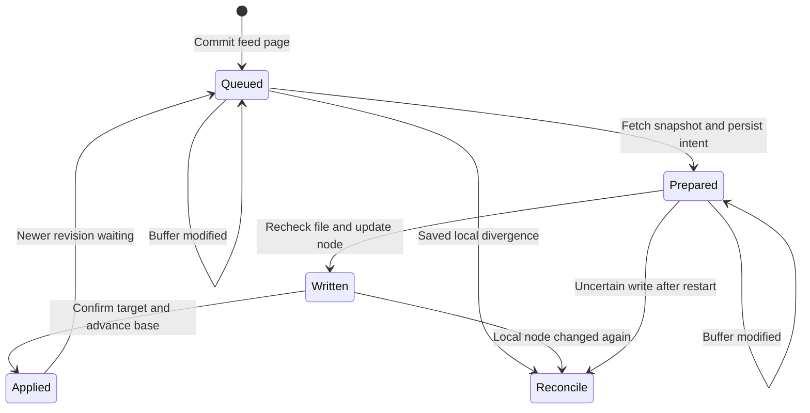

# Incremental incoming content changes

Draft protocol for existing, locally present nodes after first sync. This model covers an ordered feed of content changes and the handoff to the Org file or reconciliation. The sibling server records per-owner sequences and revisions. Its [progress ledger](../../techo/.plans/progress.md) still lists the feed endpoint as unplanned. Page tokens, snapshot semantics for initial download, and the server's eventual wire contract are open.

## Receiving a page

Poll from the durable cursor for this server and account. Accept a page only if its starting cursor matches the current cursor and it represents the next ordered segment. In one SQLite transaction record each changed node and its required revision, then advance the cursor to the end of that segment. A crash before commit allows the page to replay. A crash after commit leaves every obligation recoverable. A stale page is a no-op. A failed fetch keeps the inbox entry for retry.

For content, the inbox can retain the highest required revision per node. Fetching the current node may return an even newer snapshot. Applying that snapshot satisfies older content notifications for that node only. The account cursor advances exclusively by consuming feed pages. Lifecycle events, purge tombstones, locally missing nodes, and graph edges need their own handling before applying this rule to a mixed feed.

## Applying an inbox entry

A modified buffer gates application for every node in its file. Other files remain eligible. The buffer indicator counts distinct queued nodes including prepared writes. Before changing the file, check the current buffer modification state, file version and expected node content again. Locate the node by ID and preserve sibling headings and unrelated Org text. A saved divergence is handed to the agreed reconciliation rules, which can merge independent fields or request review for competing prose edits.

SQLite and an Org file have separate commit boundaries. First persist the intended target and its pinned base. After writing the node, confirm the on-disk content and atomically advance the base and retire only work covered by that revision. A newer notification arriving during the write stays queued. The diagram's Written state is observed from disk on recovery. If the target is already present, finish the acknowledgment. If a restart leaves a prepared intent and different disk content, this draft hands the ambiguity to reconciliation with both snapshots and the local text. This conservative choice can flag an interrupted write even when the old file was untouched.

## Verification

Run `python3 .plans/check-incoming.py` from the repo root with Python 3.10 or later. The [model](check-incoming.py) explores four content notifications for three nodes in two files, two page sizes, one unsaved editing session at a time, stale pages, and sync-worker restarts. The two nodes in the shared file are independently versioned. The third can apply while its neighbors' file is modified.

The checker explored **12,536 states and 56,555 transitions** through depth ten. Every consumed notification stayed covered by durable inbox work, an applied base, or a reconciliation handoff. Once further faults and edits stopped and the current draft was saved, all explored states drained under the modeled scheduler. Targeted traces cover a save to a sibling heading, a restart on either side of the file write, and an older acknowledgment racing a newer notification.

The model represents content with tokens. It assumes atomic SQLite transactions, whole-file replacement, and a serialized final file check and write. Org serialization, buffer reload, concurrent external filesystem writers, and actual power-loss durability require integration tests. The [bootstrap machine](bootstrap.md) covers initial discovery and passes its consumed cursor to incremental sync.
