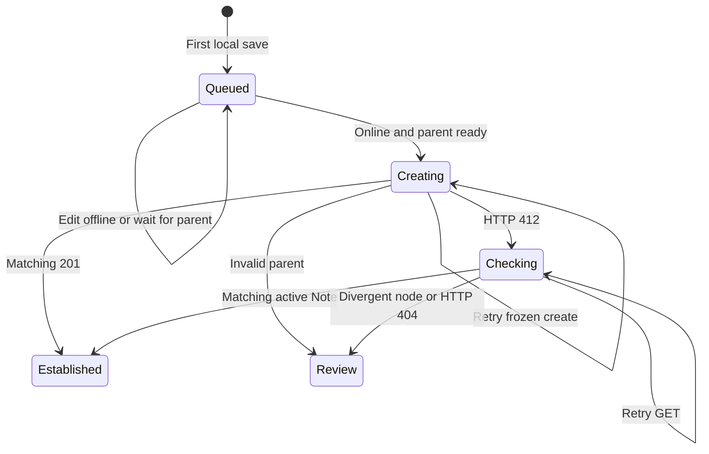

# Offline Note creation

One locally authored Note, from its first successful Org save to its first agreed server revision. On capture, generate a UUIDv7 once and save it in the Org file. Index the Note immediately for offline lookup, completion and collection membership. Queue creation under that ID, scoped to the configured server and account. A rescan after a crash between the file save and the SQLite transaction must recover the saved ID.

## State diagram

**Established** hands the observed server base and latest saved local version to the [upload machine](note-upload.md). Equal content is clean. A newer body edit is pending against the observed revision. A later parent change belongs to the move workflow. **Review** preserves the local Note, frozen request and remote observation for explicit resolution.

## Transitions and effects

| Event | Durable effect and next action |
|---|---|
| Save while queued | Keep the latest saved content under the same UUID. A child of a locally created Project or Journal waits for confirmation that its parent exists. |
| Dispatch | Persist the frozen create payload before sending `PUT /v1/nodes/{id}` with `If-None-Match: *`. Include the parent on create when assigned. Link targets can be created independently and graph edges submitted later. |
| Edit while creating or checking | Save the local edit and preserve the frozen payload. Retrying a create uses the same ID, account and payload. |
| Timeout, restart or lost response | Retire the callback token. When online, resume the durable phase with a fresh token. In Creating, replay the conditional PUT. In Checking, repeat the GET. A delayed original PUT can still reach the server. Only one conditional create can succeed at that ID. |
| Current PUT returns 201 | Atomically record the returned Note and JSON revision as the agreed base, retire the attempt and compare against the latest local save. |
| Current PUT returns 412 | Persist Checking, then GET the same ID. A 412 establishes that the ID was occupied when the server judged the create. |
| GET returns a matching active Note | Compare ID, kind, title, body, content type, parent and canonical props with the frozen create. Adopt the observed revision, even if it has advanced beyond 1. Equality establishes an agreed state. Attribution to a particular request is unavailable. |
| GET returns different fields, a different kind, or a changed lifecycle state | Preserve the local and remote versions for review. A mismatch could be someone else's edit since a successful create or a pre-existing same-account node. There is no confirmed merge base from this observation alone. |
| GET after 412 returns 404 | Stop automatic creation for this Note and report that the UUID is occupied and unreadable. Other-account nodes and purged IDs both produce this sequence. Preserve the identity and local links. |
| Server rejects the parent | Surface the parent issue for resolution. Keep the intended parent and local Note. |
| Late callback | Ignore a callback whose request token has retired. Other nodes continue syncing while this one waits or needs review. |

The parent check before dispatch is advisory. A parent can become invalid on the server after the client observed it. The protocol follows the create, ownership and purge rules in the [sibling API guide](../../techo/docs/api.md).

## Executable verification

Run `python3 .plans/check-note-create.py` with Python 3.10 or later. The [model](check-note-create.py) uses an independent server with an atomic create-if-absent rule. Request execution, reply delivery, disconnection and local saves are separate events.

The named checks cover offline edits before first dispatch, lost requests and responses, a delayed original racing its replay, a peer edit before recovery, visible and unreadable ID collisions, and both waiting for and losing a parent. One trace passes its recovered base into the existing upload model: A is created at revision 1, B is saved offline while the response is lost, and the upload machine delivers B at revision 2.

Breadth-first exploration to depth 12 reached **11,265 states and 42,119 transitions** across five initial server configurations. Checks cover stable identity, frozen payloads, local-save preservation, immutable occupied slots, callback ownership and justified base adoption. For every reached state, restoring connectivity, supplying any pending parent confirmation and draining messages FIFO reaches handoff or review within 32 steps (or stays empty before capture).

Bounds are one Note ID, two local body values, one possible peer edit and two messages on the wire. Other fields are varied in targeted collision tests. Offline capture begins at the file-save boundary. Actual disk durability, indexing performance, wire serialization, credential handling and graph publication require separate integration tests. Parent rejection and identity review are handoffs. Their resolution UI remains open.
