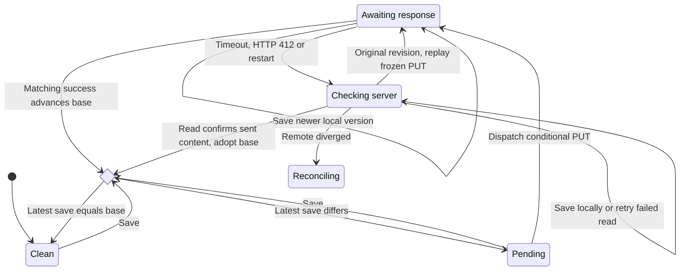

# One Note upload

Discussion draft. This machine covers content edits to an existing Note. Its starting point is a local file and a server node that agree at revision 7. Creation, moves, trashed nodes and the merge UI have their own transitions.

## State diagram

The diamond compares the latest local save with the agreed base. Reconciling hands the node to the [merge workflow](sync.md#reconciling-a-stale-write). Late callbacks for retired attempts leave the current state unchanged.

## Durable state and effects

SQLite holds the agreed base (content and server revision), the latest saved local version, and at most one outstanding upload attempt per node. Each attempt records its identity, the exact content sent, its local generation and its expected server revision. Record the attempt before sending the conditional PUT. Each PUT, replay and recovery GET gets a distinct request token. The client acts only on a callback for its current request. Tokens must remain distinct from any still-deliverable callback across recovery.

| State and event | Effect | Next state |
|---|---|---|
| Clean or pending, save | Record the latest saved version. Compare it with the base. | Pending if different, otherwise clean |
| Pending, dispatch | Freeze the attempt and issue a PUT with the base revision in `If-Match`. | Awaiting response |
| Awaiting response or checking server, save | Update the latest saved version. Keep the attempt intact. | Same state |
| Awaiting response, matching success | Atomically set the base to the accepted content and returned revision, retire the attempt, and compare the latest saved version with that base. | Clean or pending |
| Awaiting response, timeout, 412 or restart | Keep the attempt and fetch the current node. Restart can happen before the request leaves the client. | Checking server |
| Checking server, read fails | Preserve the attempt and retry the read after connectivity returns. | Checking server |
| Checking server, remote agrees with intended state | Adopt the observed content and revision as the base, retire the attempt and compare the latest save against it. | Clean or pending |
| Checking server, remote still at original base revision | Replay the frozen request with its original precondition. Either copy can succeed, and the first successful commit consumes that revision. | Awaiting response |
| Checking server, remote differs from both | Hand the base, frozen attempt, latest local save and observed remote state to reconciliation. | Reconciling |

Ignore callbacks for retired attempts. A save during an outstanding attempt can still matter when it reverts the file to its original contents. Keep that save until the request outcome is known. A read at the original revision after a timeout can race a still-running server write. Replaying the original conditional request settles which content was accepted before sending a newer save or treating an undo as clean.

## First verification cases

1. Save A, dispatch A, save B, acknowledge A. The base becomes A. B remains pending.
2. Repeat with a lost response and a restart. If the recovery read observes A, preserve B and use A's server revision for the next upload.
3. Save A, dispatch A, undo back to the original text, then acknowledge A. The undo becomes a pending write.
4. Deliver a duplicate acknowledgment for A after B is dispatched. B and its attempt remain intact.
5. Delay the server commit of A until after a recovery read sees the original revision. The client must eventually reconcile the late commit with the latest local save.

## Executable verification

Run `python3 .plans/check-note-upload.py` from the repository root with Python 3.10 or later. The [executable model](check-note-upload.py) separates the pure client transitions from a server that applies conditional writes and can commit before the client receives a response.

All five named traces pass. Breadth-first exploration through ten events reached 19,333 distinct model states and checked 59,604 transitions. The scheduler can reorder or drop requests and responses, initiate recovery, and interleave local saves with one peer write. After each transition, the checker verifies local-save preservation, base revision monotonicity, frozen attempt identity, and the handling of stale callbacks. From every reached state it also stops new edits and faults, then checks that FIFO delivery and retries lead to clean or reconciliation within 32 steps.

The bounds are one existing Note, its text field, three local text values, up to one peer write, and two messages on the wire. The five named traces include a duplicated acknowledgment and a late-commit sequence longer than the breadth-first bound. Timeout and restart have the same observable recovery transition in this model. File and SQLite durability are assumptions for later integration tests. Incoming change discovery and the reconciliation workflow are outside this machine. Clean means the latest save agrees with the last observed base.
